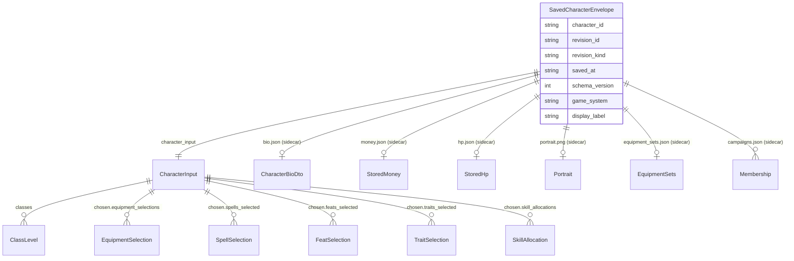
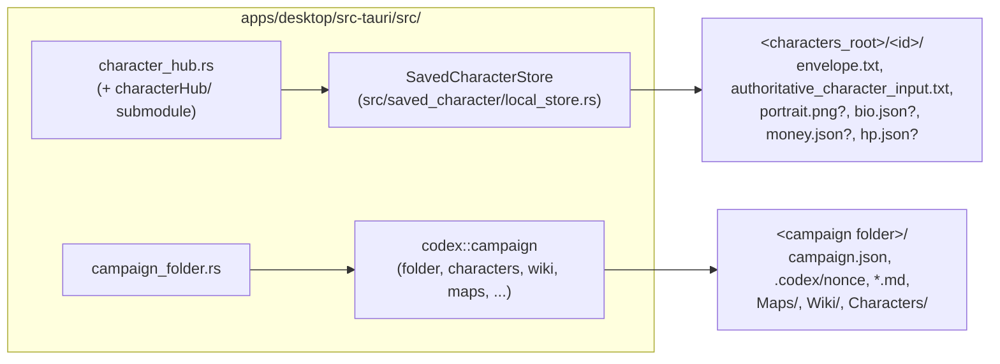

# Persistence

> Scope: how saved characters and campaigns are typed, stored on disk, and reached from the desktop shell.
> Last verified: **2026-11-20 against `tranche-22` (`fc465cddd1`, SD-42 E5.3)** for the campaign folder (`src/campaign/`: `folder.rs`, `characters.rs`, `migrate.rs`, `adventure_log.rs`, `maps.rs`, `wiki.rs`, `frontmatter.rs`; `campaign_folder.rs`), the `Characters/` backup with `master.json` and the stand-in, `campaigns.json`'s fields, the known-folders file and the `.pcg` import's sets file. Earlier pass: **2026-11-16 against `tranche-21` (`be27ecc83d`, SD-41 E5.3)** for `equipment_sets.json`, `campaigns.json`, the campaign write-through and `custom.json`'s Create-item fields. Earlier pass: **2026-11-14 against `tranche-20` (`2fd74a5c15`, SD-40 E5.4)** for the sidecar table (no `hp.json` writer; `bio.json`'s Languages, Biography and Notes). Earlier pass: **2026-11-07 against `tranche-19` (`e5c7415d7f`)** for the `ledger.json` sidecar. Earlier pass: **2026-10-15 against `tranche-18` (`9d23977679`, SD-38 closure truth-up)** for the Cyberpunk RED routing note, the
> store-ownership rule and the six-seed list below. Earlier: **2026-10-07 against `tranche/17` (`b99c3d4b02`)** for the `game_system` routing note below. The rest was last verified
> 2026-09-29 against `tranche/16`. Earlier: **2026-09-29 against `tranche/16` (`165cc205e7`)** — added the SD-36 F6e starter-seeds
> section (`starter_seeds()` is a list, each entry with its own marker; `character_hub.rs`,
> `stage-f6/f6e-receipt.md`). Prior pass **2026-09-20 against `tranche/16`, HEAD `424e93e93c`** — SD-36
> docs-truth capability pass: checked this document's claims against the fact sheet and found no
> capability/scope claim in it that needed correction (it describes on-disk mechanics, not
> product-wide coverage or "N books"/"pilot"/"proof harness" framing); no substantive change this pass
> beyond this header refresh. Prior
> pass **2026-09-20 against `b22ea9e113`** (SD-36 consolidation, architecture-docs truth-up) re-derived
> the on-disk bundle layout — a saved character now writes up to **six** files, not two, since
> `character_hub.rs` grew four sidecar files (bio/money/HP, alongside the pre-existing portrait) whose
> writes never went through `SavedCharacterEnvelope`/`CharacterInput` at all. Pass before that:
> 2026-07-21 against `deeff110a104`.
> Maintenance: updated at SD closure — see [README.md](./README.md) §Maintenance contract

This covers the two local-store boundaries under `src/`: `src/saved_character/`
(one saved character) and `src/campaign/` (one campaign). Both are headless —
no Tauri, no serde-free-for-all — and both follow the same shape: a typed
in-memory record, a concrete zero-field `*Store` struct with associated
save/load/list functions, and a documented on-disk layout.

## `saved_character/`: the envelope over `CharacterInput`

`src/saved_character/mod.rs` defines `SavedCharacterEnvelope` — identity,
revision, provenance, and schema metadata wrapped around the single
authoritative payload: `character_input: CharacterInput` (from
`crate::rules_core::character_input`). The envelope is not a new
representation of a character; it is bookkeeping (`character_id`,
`revision_id`, `revision_kind: SavedCharacterRevisionKind`, `saved_at`,
`schema_version`, `app_or_runtime_version`, `content_or_rules_provenance`,
`game_system`, `latest_authoritative_revision_ref`, `display_label`) plus that
one `CharacterInput` field. `CURRENT_SAVED_CHARACTER_SCHEMA_VERSION` is `2`;
schema_version 1 envelopes (no `game_system` line) still load, via
`local_store::derive_legacy_game_system`, which derives a short id like
`"pf1"` from the `content_or_rules_provenance` lineage prefix.
The field routes a load: a Starfinder 1e character is saved with `game_system` `"starfinder-1e"` (`GameSystem::Starfinder1e.id()`), and
`rule_system_adapter::load_saved_character_via_envelope` sends exactly that value to `StarfinderAdapter`; a Cyberpunk RED character is
saved with `"cyberpunk-red"` and goes to `CyberpunkAdapter`; every other value loads through
`Pf1Adapter` (see [desktop-app.md](./desktop-app.md) §"Rule-system adapter seam"). `SavedCharacterStore` saves the same
`CharacterInput` shape for Pathfinder and Starfinder; it does **not** own a Cyberpunk RED payload.

**Cyberpunk RED has its own store** (`src/rules_core/cpr/store.rs`, `CprCharacterStore`). A character is a directory under the same
characters root holding `envelope.txt` (the same `key = value` envelope grammar, `game_system = cyberpunk-red`) and
`cpr_character_input.txt` (the ten STATs), plus `cpr_sheet_choices.txt`, `cpr_lifepath.txt`, `cpr_role_choices.txt` and `cpr_kit.txt` once
the player has saved any of those. There is no `authoritative_character_input.txt`. So that the shared root can hold both, the Pathfinder
store's listing skips a directory whose envelope names a system it does not own (`local_store::owns_payload`, read through
`local_store::peek_game_system`, which reads `envelope.txt` alone): such a directory is neither a Pathfinder character nor an
unreadable entry. The Pathfinder envelope bytes are unchanged (pinned by the `render_envelope_of_the_pf_fixture_is_unchanged` test).

`SavedCharacterRevisionKind` currently has exactly one variant,
`Authoritative` — there is no autosave/recovery revision kind implemented yet,
only the type headroom for one.

### The saved-character model


*The envelope wraps one `CharacterInput`; further sidecar files hang off the same bundle directory but carry no `CharacterInput`/envelope relationship of their own — see "On-disk bundle layout" below.*

### On-disk bundle layout

`src/saved_character/local_store.rs` defines `SavedCharacterStore`, a
concrete unit struct (`pub struct SavedCharacterStore;`) with associated
functions `save`, `load`, and `list_all`. Its own module doc comment states
the layout precisely: one directory (the bundle root) containing two
authoritative files, named by the constants at the top of the file —

```rust
const ENVELOPE_FILE: &str = "envelope.txt";
const CHARACTER_INPUT_FILE: &str = "authoritative_character_input.txt";
```

- `envelope.txt` — `key = value` lines, one per envelope field (see
  `render_envelope`/`parse_envelope`).
- `authoritative_character_input.txt` — the `CharacterInput` rendered through
  the same hand-rolled `key=value` fixture grammar used elsewhere in
  `rules_core` (`render_character_input` writes it; `load_character_input_fixture`
  from `crate::rules_core::character_input` reads it back). The grammar itself
  — required-field diagnostics, repeatable keys, colon-segment choice
  encoding — is documented in [testing.md](./testing.md); this module only
  consumes it.

**Further sidecar files can exist in the same bundle directory, written
directly by `apps/desktop/src-tauri/src/character_hub.rs` rather than through
`SavedCharacterStore::save`/the envelope grammar** — none of them are part of
`SavedCharacterEnvelope` or `CharacterInput`; each is its own independent
JSON file, present only once the corresponding feature has been used at least
once for that character:

| File | Constant | Written by | Absent means |
|---|---|---|---|
| `portrait.png` | `PORTRAIT_FILE_NAME` | `save_character_portrait` | no portrait uploaded yet — `load_character_portrait` returns `None`, not an error |
| `bio.json` | `BIO_FILE_NAME` | `update_character_bio` | no bio saved yet — `load_character_bio` returns `CharacterBioDto::default()` (all-empty), not an error |
| `money.json` | `MONEY_FILE_NAME` | `adjust_character_money` | zero balance — `load_character_money` returns a zero `CharacterMoneyDto`, not an error |
| `ledger.json` | `LEDGER_FILE_NAME` (`character_ledger.rs`) | every Pathfinder change through `mutate_saved_character_at_root`, and an ability grant on the Custom tab | no ledger yet — the first load (or first change) builds one from what the character holds, each thing in the earliest slot of its kind, marked as worked out afterwards; `list_progression_ledger` reads it. The engine never reads it and no number depends on it. It also holds `admitted`: each record an Overrides flag let in, with that flag |
| `custom.json` | `CUSTOM_FILE_NAME` (`character_custom.rs`) | `save_character_custom`, `create_custom_item` (the Market's Create); an import restores it (`import_character_from_json`, behind `import_character` and `import_pcg`); `clone_character` copies it | nothing custom — `load_character_custom_at_root` returns `CharacterCustomDto::default()` (no grants, records, conditions, and every Overrides flag off), not an error. An equipment record may carry `weight_lbs`, `price_gp` and `container_capacity_lbs`, and the overrides `ignore_container_capacity`; all are serde-defaulted, so an older file loads unchanged |
| `equipment_sets.json` | `EQUIPMENT_SETS_FILE` (`src/saved_character/equipment_sets.rs`) | `equipment_sets::save` (temp file + rename), called from the desktop through `save_sets` (`character_hub.rs`): the first load of a save without one (the `Default` set, `default_from`), the move / set / buy / sell / discard / rename commands; `clone_character` copies it | the first load writes one active `Default` set from the saved `active_state`s. The file holds `schema`, the `active` set's name, every named set's `locations` (a copy a set does not name is Carried) and the `copies` map (`"<itemId>\|<bonus>\|<ordinal>"` → custom `name`, piece `quantity`, `size`). The engine never reads it: `equipment_sets::project` turns the active set into the `equipment=` lines' `active_state`s, which stay the only input the engine reads |
| `campaigns.json` | `MEMBERSHIPS_FILE` (`src/saved_character/campaign_mirror.rs`) | `set_character_campaigns` (the sheet's Campaign dialog) | no campaigns — nothing is copied anywhere. Each entry is `{ campaignId, campaignName, campaignDir, active, standIn, lastBackupCounter }` (`Membership`); `active: false` keeps the old backup and stops new ones; `standIn: true` (a character imported from another device's backup) never writes a backup; `lastBackupCounter` is the save counter this install last wrote to that campaign's backup. `clone_character` does not copy it, and it is never copied into a campaign folder |
| `hit_points.json` | `HIT_POINTS_FILE_NAME` | `create_character` (the per-level hit point results), an import (`import_character_from_json`); `clone_character` copies it | no saved results — `load_character_hit_points_at_root` returns an empty list, not an error |

The first three (`portrait.png`, `bio.json`, `money.json`) share one design rationale, stated directly in `character_hub.rs`'s
own comments: each is data the rules engine does not need to compute a
character (money, narrative bio fields, a portrait image),
so none of it belongs in `CharacterInput` — putting it there would make it
rules-engine-visible and force every consumer of `CharacterInput` to handle
fields with no mechanical meaning. Each sidecar's write function requires the
character to already exist (checked via `SavedCharacterStore::load` for
bio, `root.exists()` for the portrait) — none of the three is ever the first
write to a character's directory. `money.json` persists only the canonical
`total_copper` integer; the platinum/gold/silver/copper breakdown in the wire
DTO is always derived fresh via `money::copper_to_denominations`, never
stored redundantly. The app does not track hit points: an older save may
still hold an `hp.json` sidecar, which loads and is ignored. `bio.json` also holds the
Languages list (the load response's `languages.known` reads it; none means Common), the Biography
text and the Notes text (`CharacterBioDto`). Portraits are capped at
`MAX_PORTRAIT_BYTES = 3 * 1024 * 1024` bytes as a defensive backstop (the
frontend crops/resizes before sending bytes — see [desktop-app.md](./desktop-app.md)).

**Campaign write-through (the `Characters/` backup).** Every write of a file under a character root ends with
`after_write(root)` (`character_hub.rs`): for each active, non-stand-in entry in `campaigns.json` it calls
`campaign_mirror::mirror`, which copies the whole root (except `campaigns.json`) to
`<campaignDir>/Characters/<slug>-<characterId>/` by writing `<folder>.tmp-<pid>` and renaming it over
the old copy (the rename retries once after `WRITE_RETRY_DELAY`, 200 ms). The backup also holds
`master.json` (`MASTER_FILE`): the writing device's id and name (`DeviceIdentity`, kept in
`<app data>/device.json`, `DEVICE_FILE`; the name is set by `set_device_name`) and the next save counter.
A backup whose `master.json` counter is not the `lastBackupCounter` this install last wrote is left alone,
with a warning naming the device that changed it and when: one master per character, never silently
overwritten. The local copy is the master; another device reads a backup only through
`campaign::characters` (`list`, `import` as a stand-in or as the moved master, `diff` — shown, never
merged). A missing or unwritable campaign folder is a warning, not an error — the local save has already
succeeded, and a missing campaign folder is never created. The desktop keeps the latest warnings per root
in memory and the load response returns them as `mirrorWarnings`. Envelope saves go through
`save_and_mirror` (`SavedCharacterStore::save_with_warnings`; the plain `save` mirrors and drops the
warnings). A Cyberpunk RED root is identified through `CprCharacterStore::load`. The source-scanning test
`apps/desktop/src-tauri/tests/every_character_root_writer_mirrors.rs` fails when a writer under a
character root does not call `after_write`.

`SavedCharacterStore::save` refuses to write a record it cannot honestly read
back: `validate_character_input` rejects any field containing a newline (the
grammar is line-based) and enforces that `selected_choices` entries have the
exact colon-segment shape the loader expects (`choice_set_id` = exactly two
segments, `selection_id` = at least two) — see the doc comment directly above
`validate_character_input` in `local_store.rs`. `SavedCharacterStore::save`
also validates the envelope fields are single-line before writing
`envelope.txt`. The sidecar writers above do not share this validation
path — each does its own narrow shape check (e.g. bio field values just need
to serialize as JSON; there is no line-based grammar to protect there).

`SavedCharacterStore::list_all(characters_root)` walks every subdirectory of
`characters_root`, sorted by file name, and calls `load` on each
independently — `load` reads only `envelope.txt` and
`authoritative_character_input.txt`; the sidecar files are not touched by
listing. A `NotFound` root returns an empty `SavedCharacterListing`
(not an error — no characters yet is not a failure). One unreadable
subdirectory is collected into `SavedCharacterListing::unreadable_entries`
(as a `SavedCharacterListingError { entry_name, message }`) without failing
the rest of the listing.

## `campaign/`: the campaign folder

A campaign is a folder the player chooses and syncs however they like (`src/campaign/folder.rs`'s module
comment). Campaigns are not rules-computation, so `src/campaign/` is a sibling of `saved_character`, not
under `rules_core`. Everything in it is plain file IO, called from the desktop's `campaign_folder.rs` commands;
every path a command takes inside a campaign goes through `folder::relative`, so no
command reads or writes outside the folder.

```text
<campaign folder>/
  campaign.json            # CampaignFolderSnapshot (schema 2): name, rule set, description, members, dates
  .codex/nonce             # the conflict counter
  Party Resources.md       # free Markdown; a starter on request (create_party_resources_starter)
  Adventure Log/*.md       # one file per session per author; frontmatter read by frontmatter::parse
  Maps/<name>.png|jpg|jpeg + Maps/<name>.md   # pins in the .md frontmatter, as fractions of the image
  Wiki/{NPCs,Places,Factions,Items}/...       # free folders; one page per .md
  Characters/<slug>-<id>/  # the members' character backups, each with master.json (above)
  Attachments/             # images dropped into the editor (save_attachment)
  Custom Items/<name>.json # custom item exchange files (export_custom_items / import_custom_items)
```

`folder::create_layout` makes every directory in `LAYOUT_DIRS` (11) and writes `campaign.json`;
`folder::open` reads it with its nonce. `CampaignFolderSnapshot` (`CAMPAIGN_FOLDER_SCHEMA_VERSION = 2`)
holds no assets and no party: the files are the assets and `Characters/` is the party. Members are
`FolderMember { name, added_at }` — no email, no invite, no role; the creator is member #1. The other
modules read the layout: `adventure_log` (`list`, `new_entry`; a file whose frontmatter is missing or
unreadable is listed by filename and never rewritten), `maps` (`list`, `add_map`, `pins`, `set_pins`),
`wiki` (`folders`, `add_folder`, `rename_folder`, `delete_folder`, `pages`, `new_page`, `resolve_link` by
`title` then filename stem across the whole folder, `backlinks`, `search` by title then text),
`frontmatter` (the YAML subset Obsidian writes; anything else is kept as raw text), and `characters` (the
backups, above).

**Known folders.** The app remembers the campaign folders it has created or opened in
`<app data>/campaign-folders.json` (`KNOWN_FOLDERS_FILE`, `campaign_folder.rs`): `list_known_campaigns`,
`add_known_campaign_folder`, `forget_known_campaign_folder`. There is no fixed campaigns root.

**Conflict detection.** `CampaignStore::save_campaign_json_with_conflict_detection`
(`src/campaign/local_store.rs`, behind `save_campaign_json`) compares the caller's nonce with
`.codex/nonce`; on a mismatch the other writer's `campaign.json` is copied to
`.codex/conflicts/<timestamp>/` before the new one is written and the nonce bumped. Local always wins;
there is no merge UI. Only `campaign.json` is versioned: the folder's other files are written one by one
by their own screens (the editor warns when its file changed on disk).

**Migration** (`src/campaign/migrate.rs`, `migrate_campaign`). A pre-folder campaign has one of two
sources: the old localStorage record (`codex.campaigns` + `codex.campaign.assets.<id>`, passed in as the
raw JSON the UI read) or a folder holding `.config/<name>.json` (schema 1, `CampaignSnapshot`, the older
`CampaignStore::save` layout with lower-case `resources/`, `adventure-log/`, `maps/`, `wiki/`). Either
becomes a new campaign folder with one Markdown file per old entry. The old data is written first to
`<app data>/campaign-migration-backup-<date>.json`; nothing is deleted (a `.config/<name>.json` is
renamed `.json.bak`, so a second run finds nothing). The Campaign Manager opens the migration screen by
itself while older campaigns exist. `CampaignSnapshot` and the schema-1 `CampaignStore` functions remain
only for this read.

## Reaching these stores from the desktop


*Two independent Tauri-command surfaces, two independent headless stores, two independent on-disk layouts.*

`apps/desktop/src-tauri/src/character_hub.rs` (and its `characterHub/`
submodule) wraps `SavedCharacterStore` behind the character mutation
commands catalogued in full in [desktop-app.md](./desktop-app.md)'s command
inventory table: `create_character`, `clone_character`, `list_saved_characters`,
`load_saved_character`, `level_up_character`, `preview_level_up`, the
equipment/spell/feat/trait/skill mutation commands, the equipment-set
commands (`move_equipment_copy`, `create_equipment_set`, `rename_equipment_set`,
`delete_equipment_set`, `activate_equipment_set`), the sidecar commands
(bio/money/portrait, `set_character_campaigns`), `delete_character`, `export_character(_json)`,
`import_character`, plus `append_to_character` / `recompute_character` /
`re_save_character` over the `RuleSystemAdapter` seam. `campaign_folder.rs`
wraps `codex::campaign` behind the known-folders, create/open, file read/write/stat/tree, Adventure Log,
Maps, Wiki, `Characters/` backup, device-identity and migration commands (listed in
[desktop-app.md](./desktop-app.md)).

**Revision-id advancement is inconsistent by design today.** Most mutation
commands route through the shared `mutate_saved_character_at_root` load →
mutate → recompute → re-save tail and never advance `revision_id` — every
mutation keeps whatever `revision_id` was already on disk. Only
`re_save_character` computes a fresh `{id}.rev.N` (`N` derived from the
on-disk revision); every other write path that persists a
`SavedCharacterEnvelope` (`create_character`, `clone_character`,
`seed_default_character_if_needed`, `import_character`) still hardcodes
`revision_id: "{id}.rev.1"` at construction time.

**Starter seeds are a list, not a single hardcoded character.** `seed_default_character_if_needed`
resolves the app-data directory and calls `character_hub.rs`'s `seed_default_characters_at`, which
walks `starter_seeds()` — six `StarterSeed` entries: three Pathfinder ones (tranche-17-ui brief 3) — Aldric Ironhand (Human Fighter 3),
Elowen Ashgrave (Human Wizard 5, with Fireball recorded and prepared) and Brother Tomas Vane (Cleric 3 / Fighter 2,
id `00000000-0000-0000-0000-000000000003`) — and three Cyberpunk RED ones chained on from `cpr_adapter::starter_requests` (SD-38 E7.1):
Jax Moreno (Solo, Streetrat, id `…0004`, marker `.default_character_seeded_4`), Nyx Calder (Netrunner, Complete Package, `…0005`,
`.default_character_seeded_5`) and Imani Okafor (Medtech, Edgerunner, `…0006`, `.default_character_seeded_6`). A seed is a
`StarterBuild::Pathfinder` or `StarterBuild::CyberpunkRed`; the Cyberpunk builds run the Create screen's own path
(`cpr_creation::create_at_root`) with every die fixed by the request, so a restore rebuilds the same character. Each seed carries its own marker file
(`DEFAULT_CHARACTER_SEED_MARKER` = `.default_character_seeded` for Aldric, `SECOND_SEED_MARKER` =
`.default_character_seeded_2` for Elowen, `THIRD_SEED_MARKER` = `.default_character_seeded_3` for Tomas), so an
install that already carries one seed's marker gains any later seed on its next launch without re-writing the
first. A marker keeps a deleted seed deleted on launch; the Load screen's "Restore starter characters" button
(the `restore_starter_characters` Tauri command, `restore_starter_characters_at`) is the only way it comes back. It
rebuilds every seed whose character directory is missing, ignoring the marker and rewriting it afterwards, and never
touches a seed whose directory exists. A seed whose character directory already exists on disk is never
overwritten at launch either (its marker is written instead, so a player's edits survive even a lost marker). A seed
that fails to build is reported, not dropped: the pass collects its error, `list_starter_seed_errors` returns the
latest pass's errors, and the Load screen shows "A starter character could not be created: <errors>".
Each Pathfinder seed
is built through `compose_character_input`, the same composer `create_character` uses, plus
`pf1_adapter::apply_record_and_prepare_spell_selection` for any extra spells — never a hand-written
character file — and is written only when its headless build receipt is `Computed`
(`stage-f6/f6e-receipt.md`). The full
command inventory and request/response DTO shapes are catalogued in
[desktop-app.md](./desktop-app.md); this file only names the entry points and
the on-disk shape they write.

Characters root on disk: `character_hub.rs`'s
`characters_root_from_app_data_dir` joins the OS app-data directory with a
fixed `CHARACTERS_ROOT_DIR_NAME = "characters"` subdirectory
(`resolve_characters_root` resolves the real `tauri::AppHandle` app-data
path; `resolve_character_root` joins one more path segment, `character_id`).
Campaigns root: there is none — a campaign is any folder the player chose, remembered in
`campaign-folders.json` (above).

## Versioning and migration rules

- **`SavedCharacterEnvelope`**: `CURRENT_SAVED_CHARACTER_SCHEMA_VERSION = 2`.
  A schema_version 1 envelope (no `game_system` line) still loads — the
  gap is filled by `local_store::derive_legacy_game_system`, which derives a
  short id like `"pf1"` from the `content_or_rules_provenance` lineage
  prefix rather than requiring a migration pass over old files on disk. There
  is no write-side upgrade: an old file is read compatibly, but the next save
  of that character writes schema_version 2 going forward (no migration
  script rewrites old files in place).
- **Campaigns**: `campaign.json` is schema 2 (`CAMPAIGN_FOLDER_SCHEMA_VERSION`). Schema 1
  (`CampaignSnapshot`, `CURRENT_CAMPAIGN_SCHEMA_VERSION = 1`, `.config/<name>.json`) is never opened as a
  campaign: `migrate_campaign` upgrades it into a new folder (above).
- **Sidecar files** (`bio.json`, `money.json`, `hp.json`, `portrait.png`) carry
  no schema-version field of their own. Each loader treats "file absent" as
  the only backward-compatibility case it needs to handle (see the table
  above); a genuinely incompatible future shape change to one of these would
  need its own versioning scheme, which does not exist today.

### Portrait storage

`character_hub.rs` stores a character's portrait as `portrait.png`
written directly into that character's own bundle directory via
`save_character_portrait`, `load_character_portrait`, and
`delete_character_portrait`. `load_character_portrait` returns the bytes
re-encoded as a `data:image/png;base64,...` URL, or `None` if no portrait
file exists.

## Design rule: no `*Backend` trait, no trait-object indirection

Both stores are concrete zero-field structs with associated functions, not
trait objects behind a `dyn *Backend` interface — the standing rule for any
persistence backend in this codebase. Full statement of the rule, its source
citation, and the "when to introduce a trait seam" guidance: see
[conventions.md](./conventions.md) §"Concrete zero-field `*Store` structs,
no `*Backend` trait."

## How to extend

**Add a new sidecar file to a saved character** (worked example: `bio.json`):
1. Pick a file name constant (`const FOO_FILE_NAME: &str = "foo.json"`) in
   `character_hub.rs`, next to the four existing ones.
2. Write a `save_foo_at_root(root: &Path, foo: &FooDto) -> Result<(), String>`
   that first checks the character already exists (`SavedCharacterStore::load`
   or `root.exists()`) and a `load_foo_at_root(root: &Path) -> Result<FooDto,
   String>` that returns an honest default (never an error) when the file is
   absent.
3. Wrap both in thin `#[tauri::command]` functions taking `tauri::AppHandle` +
   a request DTO, resolving the root via `resolve_character_root`.
4. Register both in `main.rs`'s `generate_handler!`, add `boundary/*.ts`
   wrappers, and add the file to this doc's sidecar table and
   [desktop-app.md](./desktop-app.md)'s mutation-command table.

**Add a new persistence backend** (e.g. a cloud sync target): do not add a
`dyn *Backend` trait seam preemptively — per the design rule above, this
codebase waits for a second concrete implementation to actually exist before
introducing trait-object indirection.

## Pitfalls

- **A sidecar file is not part of `CharacterInput` or the envelope, and will
  not appear in an exported character JSON** unless `export_character`'s
  payload builder is explicitly extended to read it — `export_character`
  builds its payload from the real on-disk envelope, and the sidecar
  files sit outside that envelope by design. `equipment_sets.json` and
  `campaigns.json` are not exported: a character imported from an exported JSON gets a fresh
  `Default` set on its first load and belongs to no campaign. A `.pcg` import is different: its
  sidecar's `equipmentSets` block becomes the new character's `equipment_sets.json` (`import_pcg_json`). Adding a sidecar file
  without checking whether export/import needs to carry it is an easy way to
  ship a feature that silently disappears on export/import round-trip.
- **`SavedCharacterStore::list_all` never reads the sidecar files** — a
  listing surface that wants to show, say, a character's current HP without
  a full `load_saved_character` round trip cannot get it from `list_all`
  alone; it would need to open `hp.json` itself, per-character, which is a
  different (and today unimplemented) code path.
- **Revision-id advancement is inconsistent on purpose, not a bug to "fix"
  uniformly** — see "Reaching these stores from the desktop" above. A new
  mutation command copied from `add_equipment_selection`'s shape will
  correctly *not* advance `revision_id`, matching every other mutation
  command except `re_save_character`.
- **The campaign nonce file has no `CampaignSnapshot` field of its own** — a
  refactor that tries to fold `CampaignSnapshot` and its on-disk shape into
  one 1:1 mapping will find the nonce is deliberately outside that mapping;
  see "Conflict detection" above for why.
- **A missing characters/campaigns root is not an error** — both `list_all`
  implementations return an empty listing for a `NotFound` root. A caller
  that treats an empty listing as "something went wrong" rather than "no
  records yet" will misreport a fresh install.
